<p align="center"></p>

<p align="center">
  <a href="https://github.com/MrDDream/PalManager/releases/latest"></a>
  
  <a href="LICENSE"></a>
</p>

<p align="center">
  <a href="https://mrddream.github.io/PalManager/">Site web</a> ·
  <a href="https://github.com/MrDDream/PalManager/releases/latest">Télécharger l'APK</a> ·
  <a href="README.md">Read in English</a>
</p>

**PalManager** est une application Android d'administration pour serveurs dédiés **Palworld**.
Elle passe par l'API REST officielle de Palworld et par l'API REST du mod
**[PalDefender](https://github.com/UltimeIT/PalDefender)** : tu pilotes ton serveur depuis ton
téléphone — suivre les joueurs, donner des items et des Pals, modérer, diffuser des messages et,
via SFTP, lire les logs, gérer les fichiers et créer des modèles de Pal.

> ⚠️ Projet non officiel, sans lien avec Pocketpair. Les données de jeu (noms et images d'objets
> et de Pals) proviennent de [paldb.cc](https://paldb.cc) et restent la propriété de leurs ayants
> droit — voir [Licence](#-licence).

<p align="center">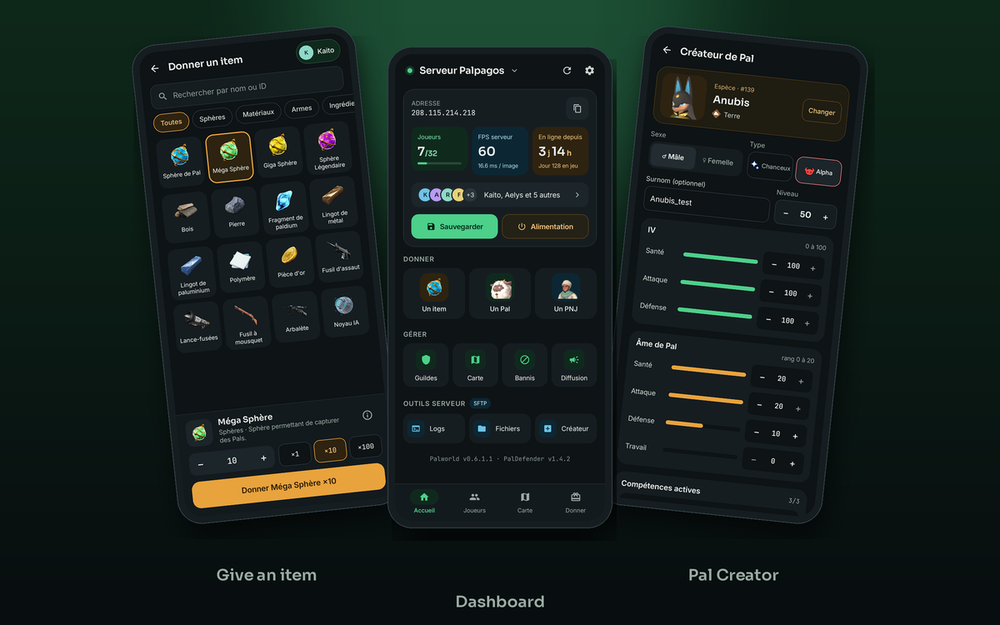</p>

## ✨ Fonctionnalités

### Serveur

- 📊 **Dashboard** — adresse, joueurs en ligne avec avatars, FPS et temps d'image, durée en ligne
  et jour en jeu, versions Palworld/PalDefender, raccourcis vers chaque outil, sauvegarde du monde.
- 🔌 **Alimentation** — programmer un arrêt propre avec délai et message aux joueurs (ton
  gestionnaire de process relance le serveur), ou forcer l'arrêt avec un bouton à maintenir.
- 🖥️ **Mes serveurs** — plusieurs profils de serveur, chacun avec son état en direct (en ligne/hors
  ligne, joueurs, FPS, latence) et les API configurées (REST, PalDefender, SFTP).
- ✅ **Vérifier** — un bouton sur l'écran d'ajout/modification de serveur teste que l'API Palworld,
  l'API PalDefender et le SFTP répondent avec les identifiants tout juste saisis.

### Joueurs

- 👥 **Joueurs connectés** — liste en direct avec recherche (nom, ID, IP) et tri (niveau, latence,
  nom), message privé, exclusion et bannissement.
- 🪪 **Fiche joueur** — onglets équipe (IV, Âme de Pal, compétences actives, passifs), inventaire,
  Palbox, progression et technologies.

### Donner

- 🎁 **Items, Pals et PNJ** — choisis le destinataire une seule fois, cherche dans un catalogue
  embarqué par nom ou par image, filtre par catégorie, élément, rareté ou métier, règle la quantité
  (×1 / ×10 / ×100) ou le niveau, et donne en un geste. Les modèles du Créateur de Pal peuvent
  aussi être donnés.

### Monde & modération

- 🛡️ **Guildes** — recherche par guilde ou par membre, membres en ligne, Pals de chaque camp,
  coffre, expéditions et recherches de labo, et toutes les bases épinglées sur la carte.
- 🗺️ **Carte en direct** — joueurs et bases de guilde sur les cartes des Îles Palpagos et de
  l'Arbre-Monde, avec zoom et sélection d'un joueur.
- 🚫 **Bannissements** — bannir et débannir des joueurs et des adresses IP.
- 📣 **Diffusion & maintenance** — annonces, alertes et messages privés, rechargement de la config
  PalDefender, redémarrage/arrêt, et une zone danger pour supprimer une base.

### 🔐 Boîte à outils SFTP (optionnelle)

Ajoute des identifiants SSH/SFTP à un profil de serveur pour débloquer :

- 📜 **Logs** — visionneuse des logs PalDefender et UE4SS avec recherche et sévérité en couleur.
- 🗂️ **Fichiers** — parcourir, envoyer (un fichier ou un dossier entier), télécharger, renommer,
  copier, couper, coller et supprimer sur le serveur, avec la clé hôte épinglée à la première
  connexion.
- 🐾 **Créateur de Pal** — construire un modèle de Pal PalDefender (espèce, sexe, niveau,
  chanceux/alpha, IV, Âme de Pal, compétences actives, passifs) depuis un formulaire et
  l'enregistrer directement dans le dossier des modèles du serveur — sans écrire de JSON à la main.

### Application

- 🌗 Thème sombre, clair ou système ; interface en français ou en anglais.
- 🐞 Journal de debug optionnel des requêtes réseau, écrit dans le dossier de ton choix, pour
  diagnostiquer les problèmes de connexion.

## 📱 Aperçu

<table>
<tr>
<td align="center"><b>Dashboard</b><br>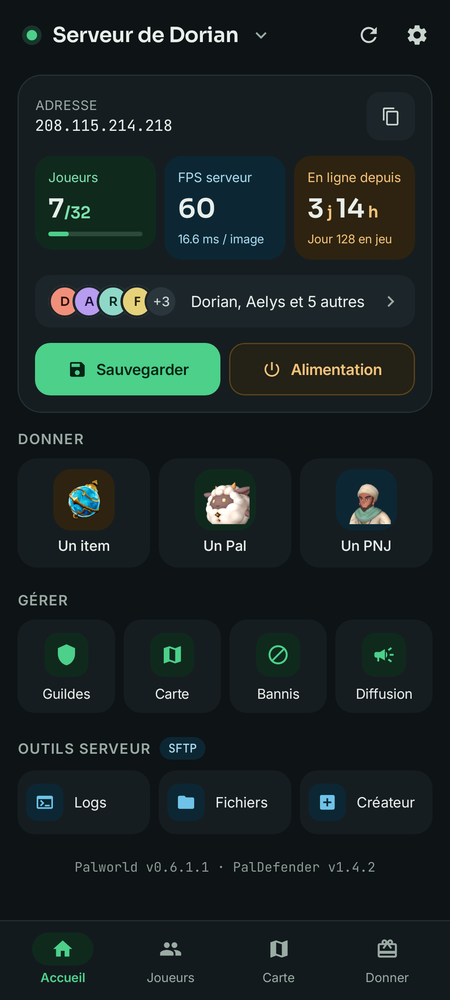</td>
<td align="center"><b>Mes serveurs</b><br>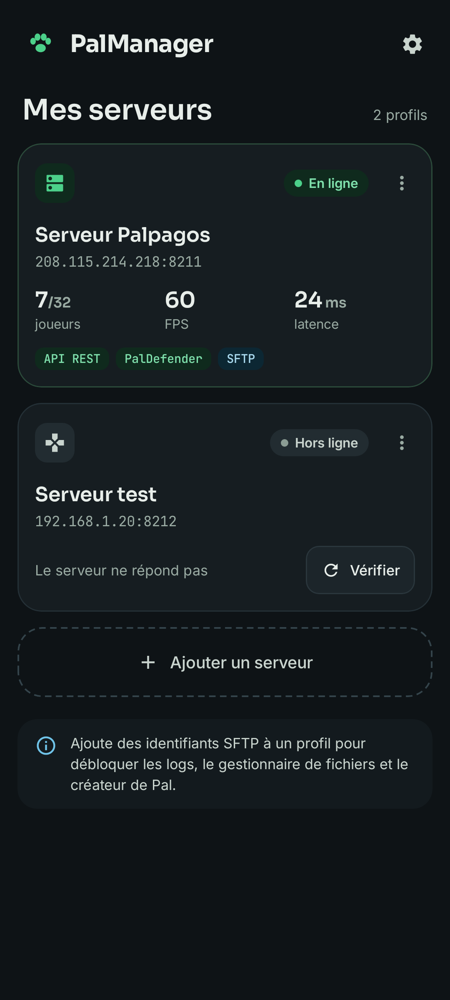</td>
<td align="center"><b>Joueurs connectés</b><br>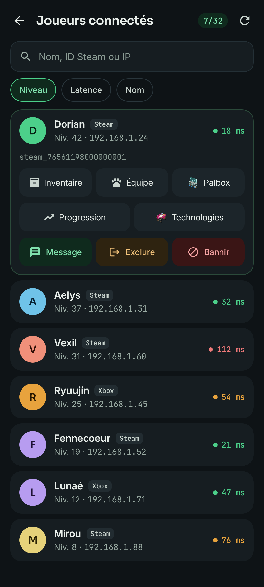</td>
</tr>
<tr>
<td align="center"><b>Fiche joueur</b><br>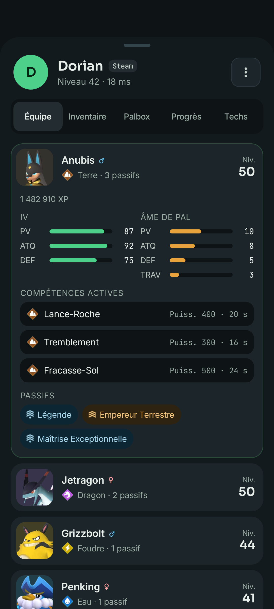</td>
<td align="center"><b>Donner un item</b><br>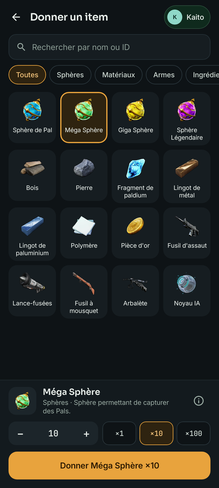</td>
<td align="center"><b>Donner un Pal</b><br>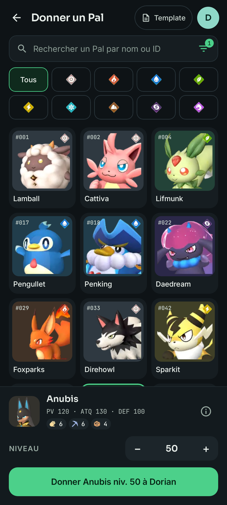</td>
</tr>
<tr>
<td align="center"><b>Guildes</b><br>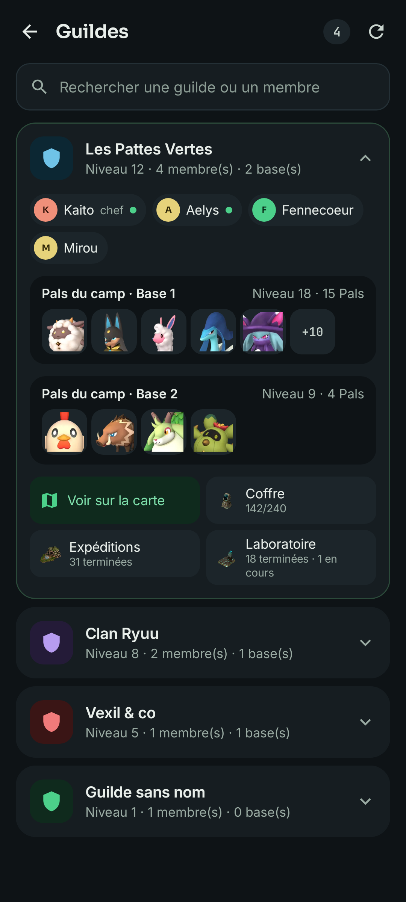</td>
<td align="center"><b>Carte en direct</b><br>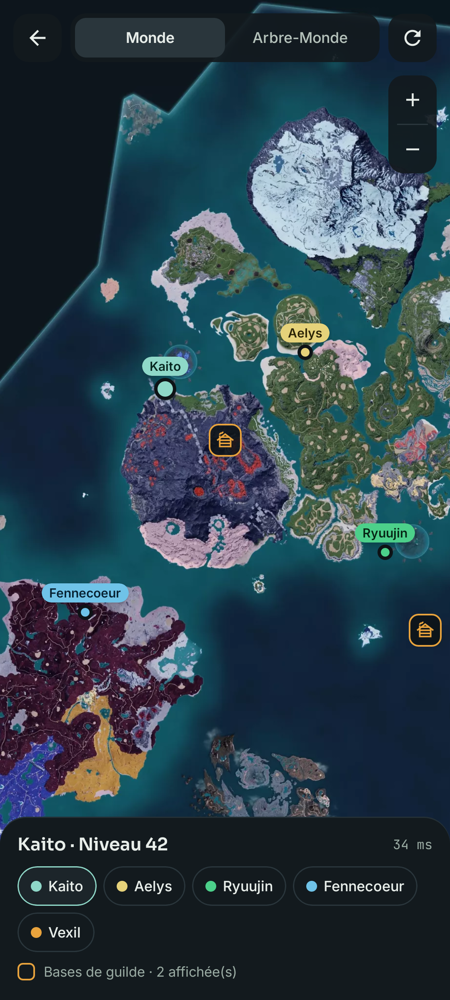</td>
<td align="center"><b>Diffusion & maintenance</b><br>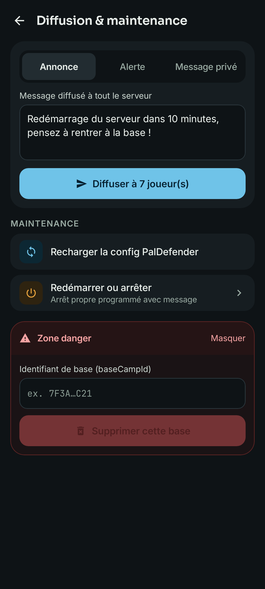</td>
</tr>
<tr>
<td align="center"><b>Fichiers SFTP</b><br>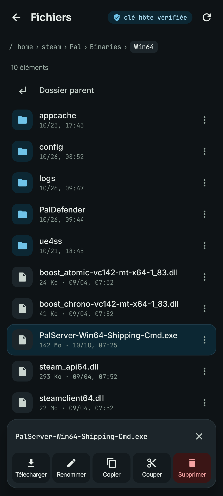</td>
<td align="center"><b>Logs</b><br>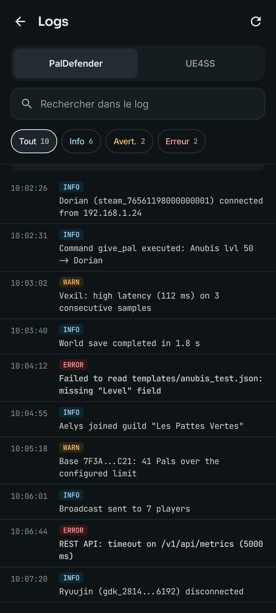</td>
<td align="center"><b>Créateur de Pal</b><br>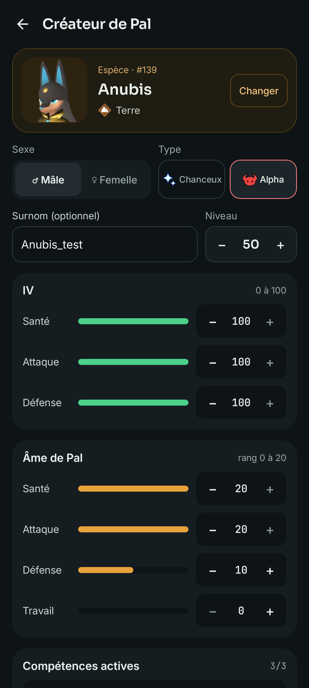</td>
</tr>
</table>

D'autres écrans (alimentation, paramètres, thème clair…) sur le [site](https://mrddream.github.io/PalManager/).

## 📥 Installation

1. Télécharge l'APK depuis la [dernière version](https://github.com/MrDDream/PalManager/releases/latest)
   et installe-le (Android 8.0 ou plus ; autorise les sources inconnues si demandé).
2. Ajoute un serveur : hôte, port de l'API REST Palworld (8212 par défaut) et mot de passe admin,
   port de l'API PalDefender (17993 par défaut) et token, et en option les identifiants SSH/SFTP.
3. Touche **Vérifier** pour contrôler que tout répond, puis enregistre.

## 🖥️ Prérequis serveur

- Un serveur Palworld avec l'[API REST officielle](https://docs.palworldgame.com/) activée
  (`RESTAPIEnabled=True` dans `PalWorldSettings.ini`).
- Le mod **[PalDefender](https://github.com/UltimeIT/PalDefender)** avec son API REST activée,
  pour ce que l'API officielle ne couvre pas (don d'items et de Pals, technologies, guildes,
  bannissements IP…).
- En option : un accès SSH/SFTP à la machine du serveur, pour la boîte à outils SFTP.

## 🔨 Compilation

Prérequis : JDK 17 et le SDK Android (API 34).

```bash
./gradlew assembleDebug
```

L'APK debug est généré dans `app/build/outputs/apk/debug/`.

### Tests visuels (Paparazzi)

[Paparazzi](https://github.com/cashapp/paparazzi) rend les écrans Compose sur la JVM, sans
émulateur. Chaque écran expose un composable sans état `XxxContent`, rendu en thème sombre et clair
par les tests de `app/src/test/java/com/paladmin/screenshots/` :

```bash
./gradlew :app:recordPaparazziDebug   # enregistrer les captures de référence
./gradlew :app:verifyPaparazziDebug   # comparer avec elles
```

Les captures de `docs/screenshots/` viennent des mêmes tests, rendus à la résolution réelle de
l'appareil :

```bash
PALMANAGER_DOCS_SHOTS=1 ./gradlew :app:cleanTestDebugUnitTest :app:recordPaparazziDebug
```

### Régénérer le catalogue items/Pals

`tools/scrape_paldb.py` récupère les données de paldb.cc pour produire
`app/src/main/assets/data/*.json` et les images associées. Le catalogue embarqué est chargé dans
une base Room (avec recherche plein texte) au premier lancement.

## 🗂️ Organisation du projet

| Chemin | Contenu |
| --- | --- |
| `app/src/main/java/com/paladmin/ui/` | Écrans Compose, un package par écran, plus `theme/` (couleurs, polices) et `components/` (composants de design partagés) |
| `app/src/main/java/com/paladmin/data/` | Clients REST (Palworld, PalDefender), client SFTP, base Room, préférences, dépôts |
| `app/src/main/assets/` | Catalogue de jeu embarqué (JSON) et images |
| `app/src/test/` | Tests de captures Paparazzi et leurs images de référence |
| `docs/` | Site GitHub Pages, images et captures du README |
| `tools/` | Scripts de récupération et d'enrichissement du catalogue |

## 🛠️ Stack technique

Kotlin, Jetpack Compose (Material 3), MVVM, Hilt, Room, Retrofit/OkHttp avec
kotlinx.serialization, Coil, Navigation Compose, DataStore, sshj, Paparazzi.

## 📄 Licence

Le code de ce dépôt est publié sous licence [MIT](LICENSE).

Les données de jeu embarquées dans `app/src/main/assets/data/` et `app/src/main/assets/images/`
(noms, statistiques, images d'objets, de Pals et de technologies) sont extraites de paldb.cc et
restent la propriété de leurs ayants droit respectifs (Pocketpair). Elles ne sont pas couvertes
par la licence MIT et sont incluses à titre non commercial, pour le fonctionnement de l'outil.
